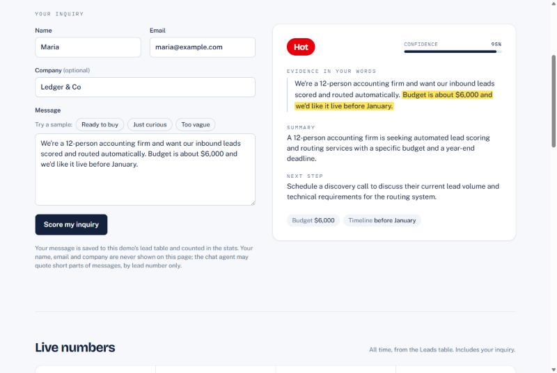
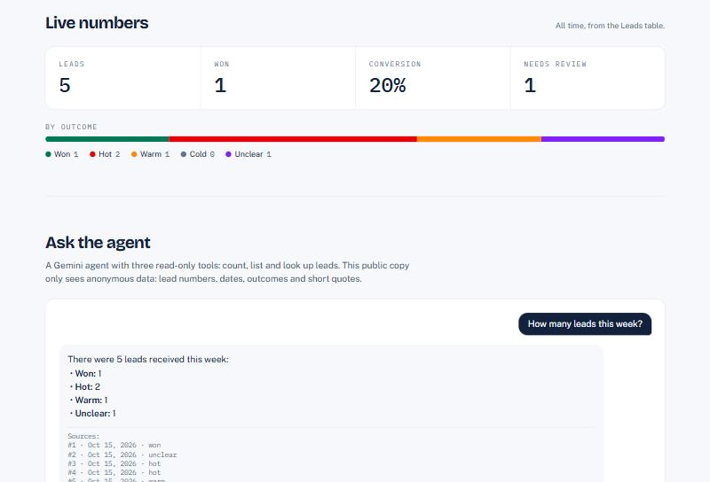
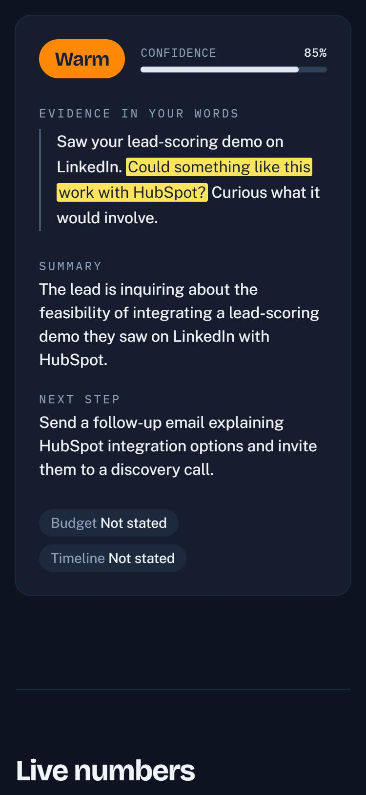
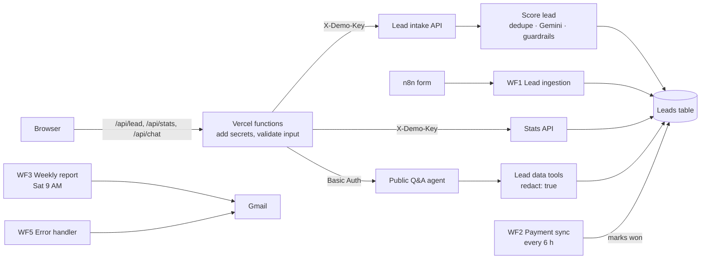

# Lead Intelligence Demo

A public demo page for a live AI lead-scoring system built in **n8n**. Send an inquiry and Gemini rates how likely it is to become a paying client, and it has to **quote the exact words** that justify the verdict. The page also shows live stats, lets you ask an agent about the leads, and explains how the five workflows fit together.



| Live numbers and the Q&A agent | Phone, dark mode |
|---|---|
|  |  |

## What a visitor can do

- **Try it:** submit an inquiry (or click a sample) and get the verdict in about 3 to 10 seconds: outcome, confidence, the evidence highlighted inside their own message, a summary, a next step and budget and timeline.
- **Live numbers:** leads, won, conversion rate and needs review, computed from the stored rows.
- **Ask the agent:** a Gemini agent with three read-only tools (`count_leads`, `find_leads`, `get_lead`) that only sees anonymous data.
- **How it works:** the workflows and the guardrails, on the page.

## How it's built



The browser never talks to n8n directly and never sees a key. The three functions in [`api/`](api) add the credentials server-side, validate input with the same limits as n8n, and pass n8n's status codes through.

| n8n workflow | Trigger | Role |
|---|---|---|
| Demo · Lead intake API | `POST /webhook/lead-demo/intake` (Header Auth) | Honeypot, input check, rate limits (5 per email, about 50 a day), then Score lead. Every path responds: 200 / 400 / 429 / 502 |
| Demo · Score lead | Sub-workflow | Normalise → dedupe → Gemini → validate → save. Returns the row or `{ duplicate: true }` |
| Demo · Stats API | `GET /webhook/lead-demo/stats` (Header Auth) | Aggregates only, never names, emails or messages |
| Demo · Public Q&A agent | Chat webhook (Basic Auth) | Copy of the private agent; its tools always pass `redact: true` |
| WF1 to WF5 | Form, schedules, error trigger | The original system: form intake, payment sync, Saturday report, private agent, error alerts |

### Guardrails

- **Evidence or nothing.** The verdict must quote words that appear in the message, or the lead is marked unclear.
- **Hot needs 80% confidence.** Below that it's held back as unclear; below 70% it's flagged for human review.
- **Payments beat opinions.** Payment > manual override > AI.
- **Numbers come from code.** Counts and conversion are computed over stored rows, never by the AI. Spam is excluded.

### What's public

- Stats are aggregate counts only.
- The public agent's tools return lead number, date, outcome, a short evidence quote and, for one lead, a 200-character message excerpt. They never return names, emails, companies or AI summaries, and search only matches message text, so nobody can check whether an email is in the table.
- A hidden honeypot field catches bots: they get a believable fake result and nothing is saved.

## Run it locally

Requires Node 24.

```bash
npm install
cp .env.example .env.local   # then fill in N8N_DEMO_KEY and N8N_CHAT_AUTH
npm run dev                  # http://localhost:5173, /api is served by a dev-only Vite middleware
```

| Variable | What it is |
|---|---|
| `N8N_BASE_URL` | The n8n instance, for example `https://luwisiii.app.n8n.cloud` |
| `N8N_LEAD_PATH`, `N8N_STATS_PATH`, `N8N_CHAT_PATH` | Webhook paths (prefilled in `.env.example`) |
| `N8N_DEMO_KEY` | Value of the n8n Header Auth credential (header `X-Demo-Key`) |
| `N8N_CHAT_AUTH` | `user:password` of the Basic Auth credential on the public chat trigger |

All of them are server-side only. Keep them in `.env.local` locally and in the Vercel dashboard in production; `.env*` is git-ignored (except `.env.example`).

If requests to n8n fail with `upstream_unreachable` and the dev server logs `unable to verify the first certificate`, something on the machine (often antivirus) is inspecting HTTPS. Start the dev server with `NODE_USE_SYSTEM_CA=1` so Node trusts the Windows certificate store.

## Scripts

| Command | Does |
|---|---|
| `npm run dev` | Vite dev server with the `/api` functions |
| `npm run lint` | oxlint |
| `npm test` | Vitest: proxy validation, auth headers, status pass-through, caching |
| `npm run build` | Typecheck (`tsc -b`) and production build |

CI runs lint, test and build on every push and pull request to `main`.

## Layout

```
api/            Vercel functions: lead.ts, stats.ts, chat.ts, shared _n8n.ts, tests
src/            React page: TryIt (form), ResultCard, Stats, AskAgent (chat), HowItWorks
docs/           Screenshots
```

The screenshots replay real responses recorded during testing, so taking them didn't spend Gemini calls.
